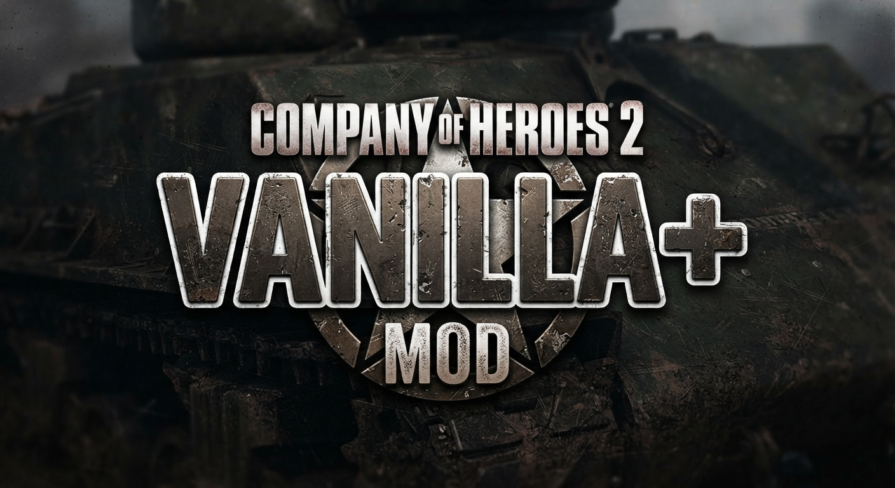

# Vanilla+ (Company of Heroes 2 tuning pack)

**Vanilla+** is built on **Kriegspiel V5 – Realism Overhaul**. It keeps Kriegspiel's gameplay and
damage model, and adds cleaner vanilla-style gunfire, shorter ranges, a more aggressive AI and an
optional Radio Man upgrade for support weapons.

## What's different from Kriegspiel V5

- **Same damage as Kriegspiel.** The physical bullets, criticals, morale and stats are unchanged, so MGs still mow down infantry.
- **Cleaner gunfire.**
  - Rifles, SMGs, pistols and snipers fire subtle rounds.
  - Machine guns (infantry, tank, halftrack, car and plane) keep the heavy tracer look.
  - Vanilla impact effects replace the phosphorus and other custom ones.
- **Weapon ranges −20%** on every faction, for example rifles and MGs 150 → 120 and mortars 300 → 240.
- **Aggressive AI.** It keeps pushing into fortified lines, attacks from several directions, and uses smoke and artillery on MGs.
- **Radio Man** (new, optional, 60 munitions, bought per unit). Available on every mortar, infantry gun and howitzer:
  - **Mortars and infantry guns:** pick their own targets by importance. MG teams, AT guns, mortars, vehicles and garrisons come first; lone squads only when nothing better is in range.
  - **Howitzers:** gain slow auto-fire, about 1 shell every 25 s.
  - **Both:** +20% sight. Barrage and counter-barrage still work as before.
- **Performance pass for big battles.** Bullets and shrapnel no longer leave a crater decal on every hit.

## Install (local)

1. Run `install.bat`, or copy `output\VanillaPlus.sga` to
   `Documents\My Games\Company of Heroes 2\mods\tuning\`.
2. In CoH2: Custom Game / Skirmish → Game Options → Tuning Pack → **Vanilla+**.
   The list can take up to about 20 s to refresh.

## Build after changes

Install Python 3, then run `build.bat`. It rebuilds, packs and verifies the mod.
All tunable numbers (Radio Man cost and fire rate, AI values, range factor) are at the top of
`tools/build_vplus.py`.

## Credits

- **Kriegspiel V5 – Realism Overhaul** by **RebelSoldier**: the base mod, its gameplay systems and all
  of its content. https://steamcommunity.com/sharedfiles/filedetails/?id=2162940169
- **Company of Heroes 2** © Relic Entertainment / SEGA.
- RGD key dictionary from the community RGDTools by Cope, via
  [cohstats/coh2stats](https://github.com/cohstats/coh2stats).
- Vanilla+ changes: Carl Zeus Anastacio (TOGS Studio).

> Vanilla+ redistributes Kriegspiel V5 content. Get RebelSoldier's permission before publishing it on
> the Steam Workshop (see `workshop/RELEASE_CHECKLIST.md`).
