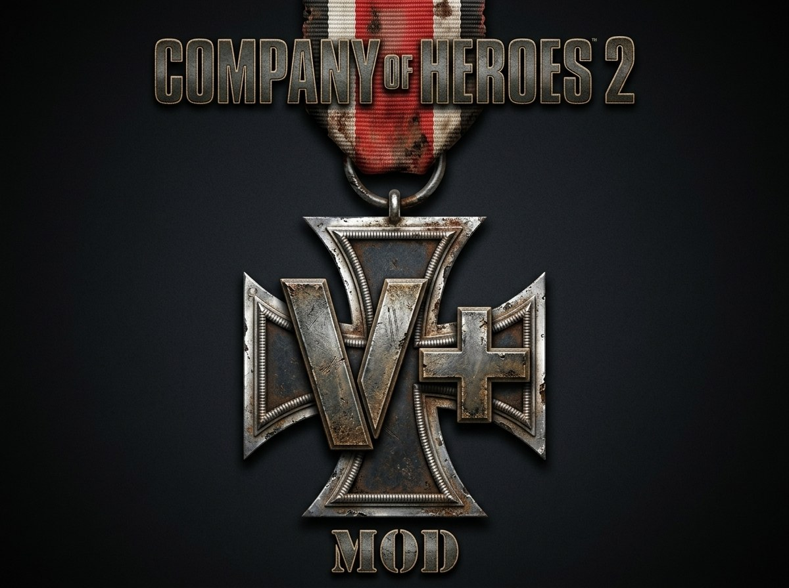

### Latest Release <a href="https://github.com/og-cz/coh2.vanilla-plus/releases/latest"></a>
[](https://github.com/og-cz/coh2.vanilla-plus/releases) [](#installation) [](#installation) [](#features) [](#building-from-source) [](#installation)
----

An ambitious, large-scale overhaul for Company of Heroes 2: real bullets, deadly machine guns and an enemy that attacks.

Version 1.2.0 · Skirmish and Custom Games · All 5 factions · Singleplayer and Multiplayer (tuning pack)

<picture></picture>
<sub>In-game screenshots coming soon.</sub>

---

## Table of contents

1. [About](#about)
2. [Screenshots](#screenshots)
3. [Features](#features)
   - [Weapons and gunfire](#weapons-and-gunfire)
   - [Engagement ranges](#engagement-ranges)
   - [Aggressive AI](#aggressive-ai)
   - [Radio Man support upgrade](#radio-man-support-upgrade)
   - [Performance](#performance)
4. [Roadmap](#roadmap)
5. [Installation](#installation)
6. [How to play](#how-to-play)
7. [Building from source](#building-from-source)
8. [Project structure](#project-structure)
9. [FAQ](#faq)
10. [Known limitations](#known-limitations)
11. [Changelog](#changelog)
12. [Credits](#credits)

---

## About

**COH2 V+ Mod** turns Company of Heroes 2 into a harder, more brutal and more realistic battlefield.
Rifle rounds are real projectiles, machine-gun nests pin and stop an assault cold, and the AI keeps pushing
into fortified lines with smoke, artillery and flanking waves instead of hiding behind its own defences.

This is a big project with a long roadmap. Version 1.0 lays the combat foundation. Future versions will
add **new units, more detailed soldiers, historically accurate elite infantry and real tank variants
that are not in the base game**.

---

## Screenshots

> Screenshots coming soon.

<!--
Put images in docs/screenshots/ and add them here, for example:


-->

---

## Features

### Weapons and gunfire

| | |
|---|---|
| **Real rifle bullets** | Every rifle, carbine and SMG round physically flies downrange. A missed shot keeps going and can hit the soldier behind your target, so firing into a crowd is deadly. |
| **Machine guns that pin** | Every machine gun (HMG and LMG teams, tank, halftrack, car and aircraft MGs) fires classic CoH2 hit-scan bursts with the classic look, hit chance and suppression, so MG nests pin infantry again. Damage, penetration, rate of fire and criticals hit as hard as ever. |
| **Subtle infantry fire** | Rifles, carbines, SMGs, pistols and snipers fire quick, low-key rounds, without big glowing tracers on every shot. |
| **Vanilla impacts** | Classic CoH2 bullet impacts and tracer speeds. No phosphorus or other custom hit effects. |
| **Deadly shrapnel** | Shells burst into fragments that kill. Cover and spacing matter. |
| **Criticals and morale** | Weapon jams, crew and engine criticals, suppression and pinning all stay part of every fight. |
| **No forced retreats** | Your squads never run away on their own. Shell shock and heavy losses stress, pin and slow them down, but only you can order a retreat. |
| **Artillery is just a gun** | Field howitzers (le.FH 18, ML-20, B-4) no longer build a scripted ring of sandbags and props when placed or spawned. |

### Engagement ranges

Ranges are realistic but not extreme. Every weapon class keeps the same balance relative to the others.

| Weapon class | Range |
|---|---|
| Rifles, SMGs, LMGs, HMGs | 120 |
| AT guns, infantry AT weapons, tank guns | 120 |
| Mortars | 240 |
| Light artillery | 320–600 |
| Heavy artillery | 320–800 |
| Flamethrowers | 20–40 |

The "hold fire" range toggles and the cast range of barrage abilities are scaled to match.

### Aggressive AI

The AI is built to **attack**, not to wait.

- **Breaks fortified lines.** It no longer treats MGs behind heavy cover as untouchable, so it keeps advancing.
- **Several attack axes.** It runs up to 4 attack objectives at once and hits the line from different directions.
- **Flanks MG nests.** Its pathing avoids firing arcs, so infantry go around the gun instead of walking into it.
- **Uses its toolbox.** Mortars, artillery and off-map strikes on static positions. Grenades and smoke are used when they matter, not thrown at every squad it sees.
- **Retreats when it's beaten.** The AI pulls back broken squads like a real commander. Nothing in the game can force *your* squads to retreat.
- **Stays on the offensive.** Squads don't camp in cover or hold one spot for long, assault squads rush, and attacks are re-launched after losses.
- **Same aggression on every difficulty.** Easy to Expert all fight the same way.
- **Fair.** It gets no extra units or production bonuses. The AI just fights better with what it has.

### Radio Man support upgrade

An optional **per-unit upgrade (60 munitions, 20 s)** for mortars, infantry guns, howitzers and rocket artillery in all factions.

**What it means:** a forward observer with a field radio joins the crew. He spots for the gun and calls in fire missions on his own.
On rocket trucks and self-propelled guns the crew gets the radio set instead (no extra soldier).

**How it plays:** the weapon starts firing **single aimed rounds by itself** at enemies your army can see. It picks the most
important target in range first: MG teams, AT guns, mortars, vehicles and garrisons. Infantry in the open come last. It is slow
and deliberate, never a spam barrage. Your manual barrages, smoke and counter-barrage work exactly as before.

| Weapon | Radio Man gives | One round every |
|---|---|---|
| Light mortars (50 / 60 mm) | +1 observer, auto fire missions, +20% sight | 12 s |
| Medium mortars (81 / 82 mm, 3-inch) | +1 observer, auto fire missions, +20% sight | 15 s |
| Heavy mortars (107 / 120 mm, 4.2-inch) | +1 observer, auto fire missions, +20% sight | 20 s |
| Pack howitzer, le.IG 18 | +1 observer, auto fire missions, +20% sight | 18 s |
| le.FH 18 / ML-20 / B-4 howitzers | +1 observer, auto fire missions, +20% sight | 25 / 35 / 40 s |
| Land Mattress | +1 observer, single-rocket fire missions, +20% sight | 35 s |
| Katyusha, Panzerwerfer, Calliope, Wurfrahmen | radio set, single-rocket fire missions, +20% sight | 40 s |
| Priest, Sexton | radio set, auto fire missions, +20% sight | 25 s |

The observer is a real soldier (the faction's officer model). If he dies, the fire missions keep running.

### Performance

Built for huge battles on regular PCs:

- Bullets and shrapnel fragments no longer stamp a crater decal on the terrain at every hit.
- Infantry rounds don't render a glowing shell model.
- Shrapnel fragments don't spawn an extra collision effect each.

---

## Roadmap

COH2 V+ Mod is planned as a long-term project. Upcoming work:

- [ ] **New units** for every faction
- [ ] **More detailed soldiers**: better loadouts and squad compositions
- [ ] **Historically accurate elite infantry**, including Waffen-SS formations
- [ ] **Real tank variants not in the base game**, such as Sd.Kfz. 222 scout car variants and other historical versions
- [ ] More special and rare vehicles
- [ ] Further AI work for very large battles
- [ ] More performance options

Ideas and feedback are welcome. Open an issue.

---

## Installation

### From the Steam Workshop
Subscribe on the Workshop page (link coming soon). Steam downloads it automatically.

### Manual install
1. Download `VanillaPlus.sga` from the Releases page, or build it yourself (see below).
2. Copy it to:
   ```
   Documents\My Games\Company of Heroes 2\mods\tuning\
   ```
   Or run **`install.bat`** from this folder.
3. Start Company of Heroes 2.

---

## How to play

1. **Play → Custom Game** (or Skirmish).
2. Add AI opponents. **Hard** or **Expert** is recommended to see the aggressive AI at its best.
3. **Game Options → Tuning Pack → COH2 V+ Mod**.
   *The mod list can take about 20 seconds to appear after the game starts.*
4. Start the match.

**Tips**
- Keep MGs in cover with flanks covered. The AI *will* try to go around them.
- Buy **Radio Man** on mortars, howitzers and rocket artillery to let them pick off enemy MG nests and AT guns on their own.
- Spread your infantry out. Bullets that miss keep flying, and shrapnel kills.

---

## Building from source

**Requirements:** Windows, Company of Heroes 2, and Python 3.9+ (no extra packages).

```bat
build.bat
```

This runs the full pipeline:

| Step | Script | What it does |
|---|---|---|
| 1 | `tools/build_vplus.py` | Applies every change (gunfire, ranges, AI, performance, Radio Man) and writes `modified/` plus `reports/` |
| 2 | `tools/pack.py` | Packs everything into `output/VanillaPlus.sga` with the mod's own identity |
| 3 | `tools/verify.py` | Re-reads the pack and checks integrity, references and that combat stats are unchanged |
| 4 | `tools/audit.py` | Writes `reports/AUDIT.md`: every squad in every faction and how its weapons were treated |

Then run `install.bat` to copy the result into the game.

**Tuning:** all numbers live at the top of `tools/build_vplus.py`:

| Setting | Default | Meaning |
|---|---|---|
| `RANGE_FACTOR` | `0.80` | Global weapon range multiplier |
| `RADIO['munition_cost']` | `60` | Radio Man price |
| `SUPPORT_GUNS` | see file | Which units get Radio Man and the seconds per radio shot |
| `RADIO['sight_multiplier']` | `1.2` | Radio Man sight bonus |
| `RADIO['priority']` | threat 40 | How strongly Radio Man prefers big targets |
| `COVER_RATING`, `AI_SETTINGS` | see file | AI aggression |

---

## Project structure

```
coh2.vanilla-plus/
├── build.bat / install.bat     one-click build and install
├── tools/                      build pipeline (Python)
│   ├── build_vplus.py          all gameplay changes
│   ├── pack.py                 SGA packer
│   ├── verify.py               static checks
│   ├── audit.py                all-faction audit
│   ├── rgd.py, flat.py         attribute file reader/writer
│   └── sga7*.py                archive reader/writer
├── reports/                    every changed value (CSV) + audit + verification log
├── workshop/                   Workshop banner + release checklist
├── docs/screenshots/           screenshots
├── CHANGELOG.md  MODIFICATION_LOG.md  TESTING_REPORT.md
└── (not in git) original_backup/ extracted_assets/ modified/ output/
```

---

## FAQ

**Does it work in multiplayer?**
Yes, in custom games where everyone uses the tuning pack. It is not for automatch.

**Do I need any other mod?**
No. COH2 V+ Mod is standalone.

**Bodies disappear quickly.**
The mod keeps bodies for 5 minutes. If they vanish sooner, raise **Physics** in CoH2's graphics settings. On Low, the game removes ragdolls early.

**The mod doesn't show up in the list.**
Wait about 20 seconds after the game starts, or restart the game. Check that `VanillaPlus.sga` is in `mods\tuning\`, not in `mods\tuning\subscriptions\`.

**Why don't my rifles show big tracers?**
That's intentional. Infantry fire is subtle, while machine guns use the classic CoH2 tracer look.

**Will the AI buy Radio Man?**
No. It's a player option.

---

## Known limitations

- Radio Man targeting is a strong *preference*, not a hard filter. A lone squad can still be shelled if it's the
  biggest threat in range.
- Radio fire missions only hit what your army can see. Keep a spotter or recon unit forward.
- Rocket trucks have no turret, so they may need to turn toward a target before a radio rocket goes off.
- The AI's top-level strategy script is part of the base game. The mod tunes all the data the AI uses, not the script itself.

See `TESTING_REPORT.md` for the full test plan.

---

## Changelog

See [`CHANGELOG.md`](CHANGELOG.md). Current version: **1.2.0**.

---

## Credits

- **RebelSoldier**, for the original realism overhaul this mod is built on.
- **Company of Heroes 2** © Relic Entertainment / SEGA. This is a fan-made mod, not affiliated with Relic or SEGA.
